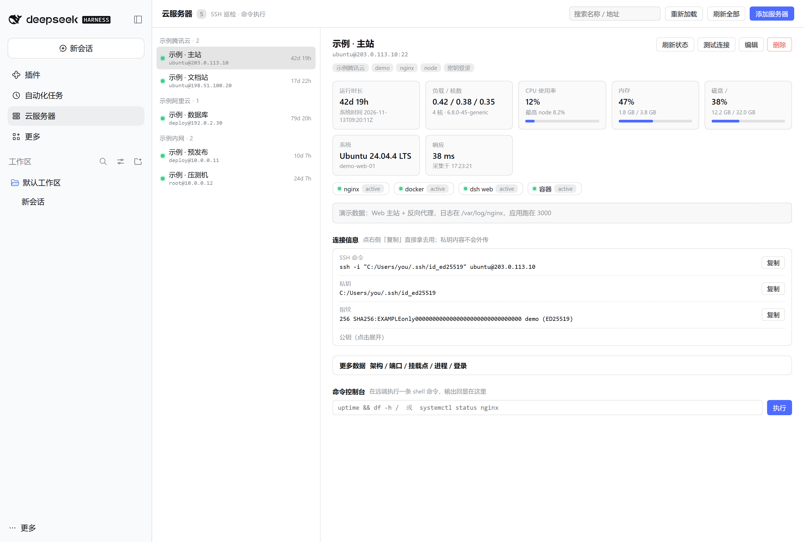
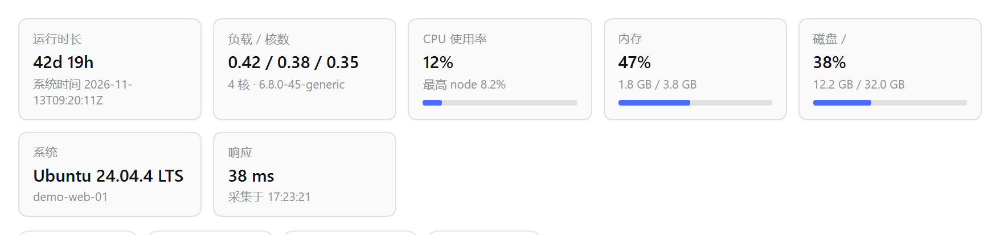
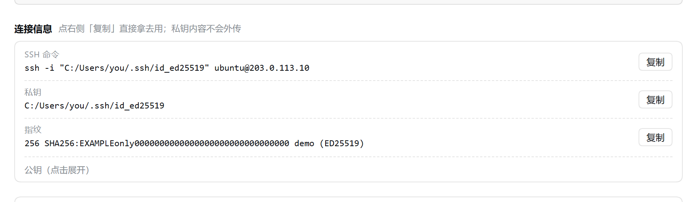
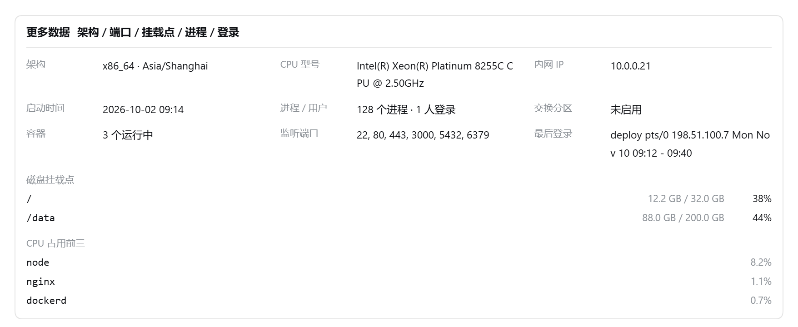
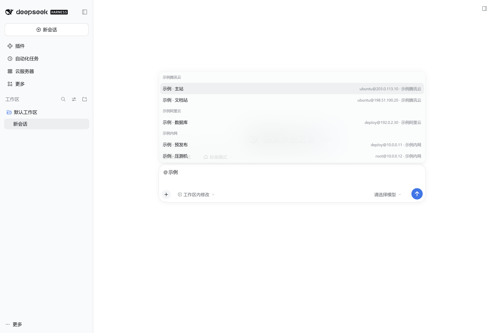
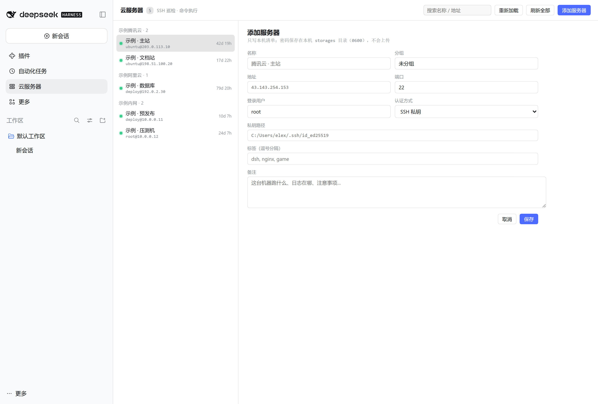

# dsh-cloud-servers · 云服务器工作台

在 DeepSeek Harness 里管你的云服务器：**登记一次，之后状态、连接信息、命令执行、对话里 @ 一台机器，全在同一个面板里**。



一个 DSH 插件（host + client 两半），SSH 交给系统自带的 `ssh`，密码交给 paramiko，不引入任何常驻进程。

📖 **图文教程**：<https://guide.lukezystudio.cn/dsh-cloud-servers/>

---

## 它解决什么

平时管十来台机器，常见的麻烦是：IP 和密钥散在备忘录里、`ssh -i` 每次都要翻历史命令、机器慢不慢只能一台台登上去看、在 DSH 里跟 AI 说「帮我看看那台主站」它还得反问是哪台。

这个插件把这几件事收进一个面板：

- **清单**：分组、标签、备注，搜索名字 / IP / 标签
- **巡检**：一次 SSH 往返拿到 20 多个指标，结果缓存 60 秒
- **连接信息**：`ssh` 命令、私钥路径、指纹、公钥，每行一个「复制」
- **执行**：面板里跑一条命令，stdout / stderr / exit code 回显
- **对话**：输入框敲 `@` 选机器，选完就是一个 chip，模型直接知道你说的是哪台

---

## 功能

### 1. 一屏看清所有机器

左侧按分组排列，绿点在线、灰点离线，右侧是选中机器的实时状态。顶部可以搜索、单机重载、全部刷新、新增。


### 2. 巡检卡片：这台机器到底怎么样

运行时长、负载与核数、CPU 使用率（含最吃 CPU 的进程）、内存、磁盘、系统版本、SSH 响应耗时，都带进度条和红黄绿分级。



采集脚本是一次 SSH 往返里的一串 `echo`，不依赖任何远端依赖：`uptime` / `vmstat` / `free` / `df` / `ps` / `who` / `last` / `systemctl` / `ss` / `docker ps`，缺哪个就跳过哪个。

### 3. 连接信息：每行一个复制按钮

这是最常用的部分。`ssh` 命令按这台机器的端口和认证方式**自动拼好**（非 22 端口带 `-p`，密码机给 `ssh user@host`），私钥路径、密钥指纹、公钥各一行，点右侧「复制」直接进剪贴板。



- 指纹是本地 `ssh-keygen -lf` 算的，不用登服务器
- 公钥默认折叠，要用再展开
- **私钥内容永远不读、不渲染**，只给路径

### 4. 更多数据：默认折叠，不占屏

架构、时区、CPU 型号、内网 IP、启动时间、进程数、登录人数、交换分区、容器数、监听端口、磁盘挂载点、CPU 占用前三、最后登录。



低频信息收在折叠区，首屏只留决策要看的几个数。

### 5. 对话里 @ 一台机器

输入框敲 `@`，候选里除了文件，还有你的服务器——按分组分节，可以继续输入名字、IP、标签过滤。



选中后草稿里是一个 chip：


提交时 chip 序列化成模型看得懂的标签：

```xml
<cloud-server id="srv-demo-web" name="示例 · 主站"
              host="203.0.113.10" user="ubuntu" group="示例腾讯云"/>
```

配套的 `cloud_servers` 工具说明里写明了这条约定，模型看到标签就直接拿 `id` 当参数，不会再反问「你说的是哪台」。

### 6. 命令控制台与新增

面板底部直接跑命令；「添加服务器」支持密钥 / 密码两种认证，密码输入框只写不读。



---

## 安装

插件通过 DSH 的 profile 加载。以 desktop profile 为例：

```bash
# 1) 把仓库放到本地任意目录，然后在 profile 里链接它
cd ~/.dsh/profiles/desktop
npm pkg set dependencies.dsh-cloud-servers="link:/path/to/dsh-cloud-servers"
```

```jsonc
// ~/.dsh/profiles/desktop/package.json
{
  "dsh": {
    "profile": {
      "bundles": ["@deepseek-ai/dsh-base", "@deepseek-ai/dsh-web-app", "dsh-cloud-servers"]
    }
  }
}
```

```bash
# 2) 装链接
pnpm install

# 3) 重启 DSH（宿主侧新增了 HTTP 路由，必须重启一次）
```

重启后侧栏出现「云服务器」。

想预置一份清单，把 `seed-servers.example.json` 复制成 `seed-servers.json` 再改；不预置也行，面板里点「添加服务器」。

---

## 凭据与安全

| 项 | 做法 |
|---|---|
| 清单存放 | `$DSH_HOME/storages/dsh-cloud-servers/servers.json`，权限 `0600` |
| 密钥登录 | 只存私钥**路径**，认证交给系统 `ssh -o BatchMode=yes -o IdentitiesOnly=yes -i <key>` |
| 面板密码 | 存本机 JSON（0600），HTTP 接口只回 `hasPassword`，不回明文 |
| 复用 skill 密码 | `passwordFrom: "ssh-log-analyzer"`，运行时去读 `~/.agents/skills/ssh-log-analyzer/scripts/ssh_log.py` 的 `SSH_USER` / `SSH_PASS`，**不复制、不落盘** |
| 密码登录 | `scripts/ssh_password.py`（paramiko），密码走 stdin，不出现在进程列表里 |
| HTTP 接口 | 只接受同源请求（`Origin` 必须与 `Host` 一致），其它本地网页借不了道 |
| 仓库 | `.gitignore` 排除 `seed-servers.json`，真实内网地址与私钥路径不入库 |

---

## 配置

`cordis.patch.yml`：

```yaml
enabled: true
allowExec: true          # 关掉就只剩查看，不能执行命令
connectTimeoutMs: 8000
statusTimeoutMs: 25000
execTimeoutMs: 30000
statusTtlMs: 60000       # 状态缓存
pythonPath: python       # 密码登录用
```

---

## HTTP API

前缀 `/cloud-servers/api`：

| 方法 | 路径 | 说明 |
|---|---|---|
| GET | `/state` | 清单 + 缓存状态 + 运行配置 |
| POST | `/servers` | 新增 |
| PATCH | `/servers/:id` | 修改（不传 `password` 即保留原密码；`clearPassword: true` 清空） |
| DELETE | `/servers/:id` | 删除（只删本地登记） |
| POST | `/servers/:id/test` | 连通测试 |
| POST | `/servers/:id/status?fresh=1` | 采集状态 |
| GET | `/servers/:id/ssh` | 连接信息（命令 / 私钥路径 / 公钥 / 指纹） |
| POST | `/servers/:id/exec` | 执行命令 `{ "command": "..." }` |
| POST | `/status-all?fresh=1` | 全量巡检（并发 4） |

---

## 对话内工具

注册 `cloud_servers`（冲突时回退 `dsh_cloud_servers`）：

- `action`: `list` \| `status` \| `exec`
- `server`: id / 名称 / IP（`exec` 必填，`status` 省略则全量）
- `command`: `exec` 要执行的命令

---

## 测试

```bash
node test/host.mjs            # 离线：种子、增删改、状态解析、跨站拦截
node test/client.mjs          # 渲染树 + @ 触发源 + chip 序列化
CS_NETWORK=1 node test/host.mjs   # 真机：连通、巡检、/ssh、执行
CS_NETWORK=1 CS_ALL=1 node test/host.mjs   # 全量巡检
```

不需要启动 DSH：host 测试用假的 ctx 与 req/res，client 测试在 `vm` 沙箱里跑一份假 React。

---

## 边界

- 只做「单条命令」，不提供交互式 shell；要交互请用系统终端
- 密码登录依赖本机 `python` + `paramiko`；没有就只用密钥机
- 内网机器需要本机已在同一网络 / VPN 里
- 状态采集是「一条 SSH 往返」，机器多时按并发 4 排队，`status-all` 大约 2 秒 / 台

## License

MIT © MrLukezy